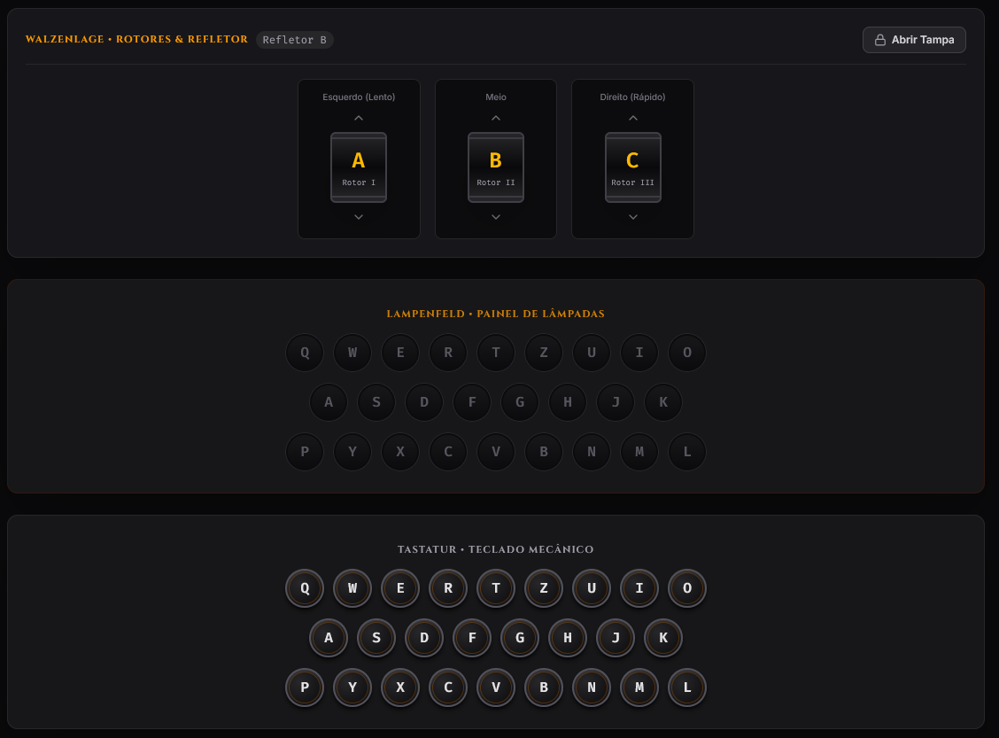
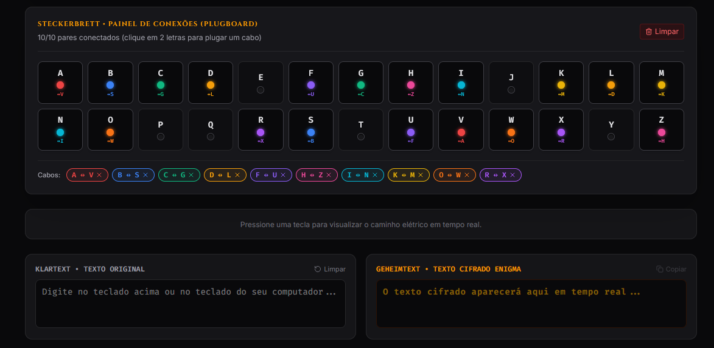
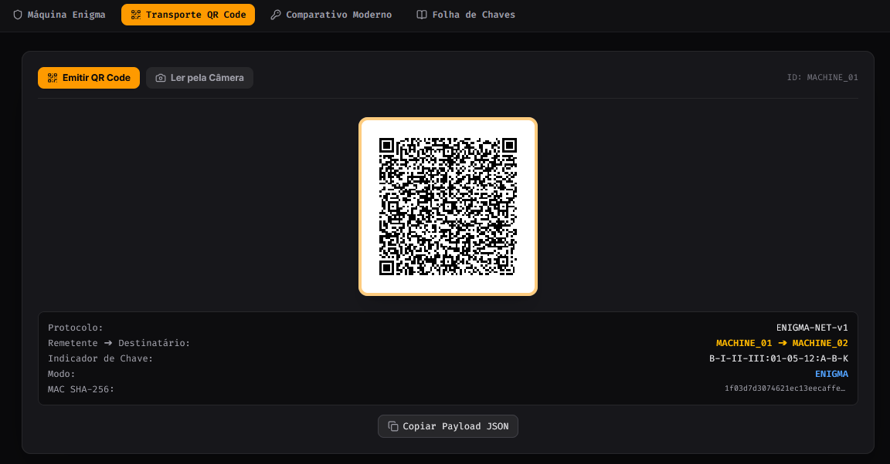
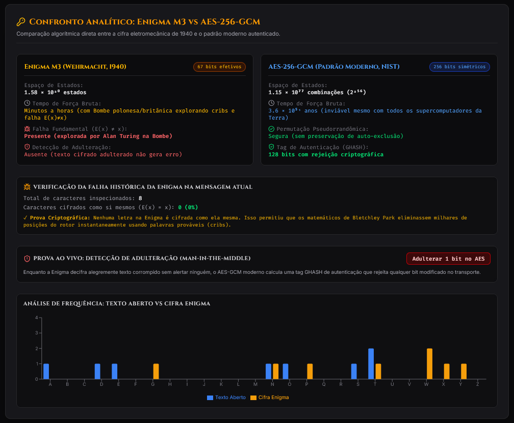
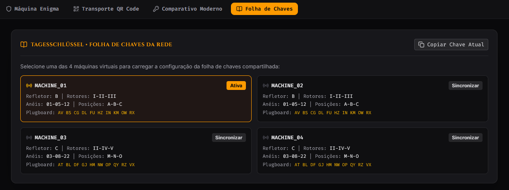
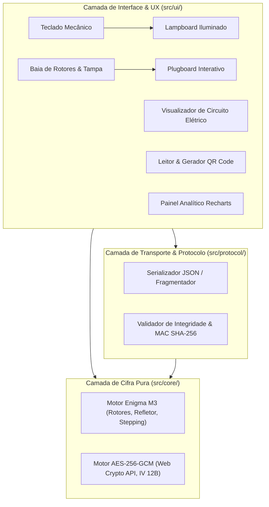

# Parábola — Comunicação Segura Air-Gapped (Enigma M3 × Criptografia Moderna)


🔗 **Repositório Oficial:** [https://github.com/aksaraymalaklisi/hackathon-maquina-enigma](https://github.com/aksaraymalaklisi/hackathon-maquina-enigma)

---

## 1. Descrição do Problema e Solução

O projeto **Parábola** explora o desafio da segurança da informação sob a ótica histórica e contemporânea. Historicamente, a máquina Enigma não foi superada apenas por deficiência de complexidade matemática, mas principalmente por **falhas arquiteturais, procedimentais e de integridade** (reutilização de indicadores, chaves operacionais capturadas e a vulnerabilidade mecânica em que uma letra nunca é cifrada como ela mesma). Esse padrão se repete em incidentes modernos de cibersegurança, onde o algoritmo criptográfico em si raramente falha; a vulnerabilidade quase sempre reside no projeto, na gestão de credenciais e no transporte desprotegido.

### Nossa Solução:
Desenvolvemos uma aplicação web multiplataforma (otimizada para computadores e celulares) que:
1. **Recria fielmente a Máquina Enigma Militar (M3/I):** Lógica matemática e mecânica pura contendo catálogo de rotores históricos (I a V), refletores (B e C), anéis (*Ringstellung*), posições iniciais (*Grundstellung*), avanço mecânico com **double-stepping** do rotor do meio e painel de conexões (*Plugboard / Steckerbrett*).
2. **Transporte Físico Air-Gapped via QR Code:** Comunicação sem internet entre 2 a 4 máquinas virtuais. A máquina remetente gera um QR Code com cabeçalho de protocolo estruturado e texto cifrado; a máquina destinatária lê pela câmera do dispositivo e decifra a mensagem.
3. **Confronto Analítico com Criptografia Moderna (AES-256-GCM):** A mesma mensagem é simultaneamente cifrada utilizando o padrão contemporâneo autenticado (Web Crypto API nativa). A plataforma exibe um painel analítico com tempo de força bruta, espaço de estados ($1.58 \times 10^{20}$ vs $1.15 \times 10^{77}$), gráfico de análise de frequência de letras e demonstração ao vivo de **detecção de adulteração de 1 bit** (ausente na Enigma e inviolável no AES-GCM).

### Demonstração Visual da Aplicação

| Máquina Enigma (Rotores, Lampboard & Teclado) | Painel de Conexões (Steckerbrett / Plugboard) |
|:---:|:---:|
|  |  |

| Transporte Físico Air-Gapped via QR Code | Painel Analítico: Enigma M3 vs AES-256-GCM |
|:---:|:---:|
|  |  |

| Folha de Chaves da Rede (Máquinas 01 a 04) |
|:---:|
|  |

---

## 2. Arquitetura em Três Camadas e Protocolo

A aplicação segue rigoroso desacoplamento arquitetural conforme as diretrizes do edital, garantindo 100% de testabilidade isolada e clareza para a arguição técnica:



### Contrato do Protocolo `ENIGMA-NET-v1` (QR Code)

O payload transmitido fisicamente entre as máquinas obedece à especificação padronizada:

```json
{
  "protocol": "ENIGMA-NET-v1",
  "sender": "MACHINE_01",
  "recipient": "MACHINE_02",
  "keyIndicator": "B-I-IV-V:01-12-24:A-B-C",
  "mode": "ENIGMA",
  "timestamp": 1729500000000,
  "payload": "KMFNWDPQMBLA",
  "mac": "e3b0c44298fc1c149afbf4c8996fb92427ae41e4649b934ca495991b7852b855",
  "part": 1,
  "totalParts": 1
}
```

* **`keyIndicator`:** Codifica `[Refletor]-[Rotores E-M-D]:[Ringstellung]:[Grundstellung]`.
* **`mac`:** Hash SHA-256 do payload, garantindo detecção imediata de adulteração no trânsito.
* **`part` / `totalParts`:** Suporte nativo à divisão de mensagens longas em múltiplos QR Codes numerados.

---

## 3. Tecnologias e Ferramentas de IA Utilizadas

Em total conformidade com os critérios do edital e diretrizes de integridade e LGPD (dados 100% sintéticos e simulados):

### Stack Tecnológica:
* **Linguagem & Framework:** TypeScript 5.7, React 19, Vite 6.
* **Estilização:** Tailwind CSS v4 (integração `@tailwindcss/vite`), design skeuomórfico retroiluminado.
* **Criptografia Moderna:** Web Crypto API nativa do navegador (`window.crypto.subtle` com AES-GCM e SHA-256 sem bibliotecas externas pesadas).
* **QR Code:** `qrcode.react` (renderização vetorial SVG) e `html5-qrcode` (leitura em tempo real pela câmera).
* **Gráficos e Estatística:** `recharts` (distribuição de frequência de caracteres e entropia).
* **Áudio Mecânico:** Web Audio API nativa com síntese de frequências procedural (zero arquivos de áudio externos, funcionamento instantâneo offline).
* **Testes Automatizados:** `vitest` (18 testes unitários puros cobrindo simetria, double-stepping e integridade).

### Declaração de Ferramentas de IA (Item 7.3 do Edital):
* **Google Gemini & Antigravity IDE:** Utilizados como copilotos de desenvolvimento para estruturação de scaffolding, geração do sintetizador procedural da Web Audio API e revisão de conformidade com os critérios de avaliação do edital.
* **Código Preexistente / Aberto:** Não houve reaproveitamento de código proprietário anterior; bibliotecas utilitárias abertas (React, Recharts, QR Code) devidamente declaradas no `package.json`.

---

## 4. Instruções de Execução

### Execução Local (Desenvolvimento & Demonstração):

1. **Clonar o repositório:**
   ```bash
   git clone https://github.com/aksaraymalaklisi/hackathon-maquina-enigma.git
   cd hackathon-maquina-enigma
   ```
2. **Instalar as dependências:**
   ```bash
   npm install
   ```
3. **Executar a suíte de testes unitários automatizados:**
   ```bash
   npm test
   # Executa os 18 testes unitários (Simetria, E(x)!=x, Double-stepping, AES-GCM, MAC)
   ```
4. **Iniciar o servidor local:**
   ```bash
   npm run dev
   ```
   Acesse no navegador: **`http://localhost:5173/`**

### Teste no Celular com Câmera (Wi-Fi Local):
Para ler o QR Code com a câmera do celular em tempo real durante a demonstração:
```bash
npm run dev -- --host
```
Abra no navegador do celular o endereço de rede informado pelo Vite (ex: `http://192.168.1.X:5173/`).

---

## 5. Divisão de Tarefas da Equipe

Conforme registrado no quadro Kanban e no histórico de commits:

| Integrante / Função | Responsabilidades Principais |
|---|---|
| **Lógica Criptográfica & Motor Enigma** | Implementação de `src/core/enigma/` (rotores I-V, refletor, anéis, double-stepping e testes de simetria). |
| **Interface Imersiva & UX** | Desenvolvimento de `src/ui/` (teclado mecânico, lampboard retroiluminado, plugboard e áudio procedural). |
| **Protocolo de Rede & QR Code** | Especificação de `src/protocol/` (transporte via QR Code, câmera mobile, validação e fragmentação). |
| **Criptografia Moderna & Analítica** | Implementação de `src/core/modern/` (AES-GCM, hashing SHA-256, Recharts e detecção de adulteração). |
| **Qualidade de Engenharia & Documentação** | Configuração do Vitest, isolamento de camadas, governança (AGENTS.md, README.md) e preparação da arguição técnica. |

---

## 6. Qualidade de Engenharia e Arguição Técnica

* **18 Testes Automatizados no Vitest:**
  * Prova de Simetria Recíproca ($D(E(m)) = m$).
  * Prova da Propriedade Anti-Reflexiva ($E(x) \neq x$).
  * Prova de Incoerência de Chave (chave incorreta produz texto ilegível).
  * Validação Mecânica do *Double-Stepping* do rotor intermediário.
  * Validação da Tag de Autenticação GHASH (rejeição de 1 bit adulterado no AES-GCM).
  * Validação de Integridade do Cabeçalho `ENIGMA-NET-v1` e fragmentação.
